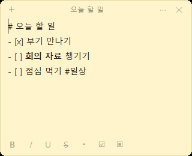

# 부기 — 바탕화면을 뒤뚱뒤뚱 돌아다니는 부산 갈매기

[부산시 캐릭터 부기](https://www.busan.go.kr/character)로 만든 데스크톱 펫입니다. 기능은 `deskPet_Neoburi`(너부리)와 **같고**, 캐릭터만 부기로 바꿨습니다.
너부리처럼 그림 파일 없이 **코드로 부위별로 그려서**(`src/Rig.cs`) 몸통·얼굴·부리·빨간 안경·머리카락·날개·꼬리·운동화가 따로 움직입니다.

## 실행
`output\bugi.exe` 를 실행하면 됩니다. 설치가 필요 없고(.NET Framework 4.8 — Windows 10/11 기본 포함), 그림은 EXE 한 개에 들어 있습니다.
설정·기록은 `%AppData%\부기\` 에 저장됩니다(`부기_설정.ini`, `부기_움직임.ini`, `부기_기록.xml`). 너부리와 따로 저장되고 동시에 실행해도 됩니다.

## 사용법 (너부리와 동일)
| 조작 | 동작 |
|---|---|
| 클릭 | 발끈(💢 + 쿵쿵) → 놀라 달달 떨며 울기 → 폴짝 뛰기 순서로 반응 (설정에서 변경) |
| 끌어서 놓기 | 살짝 놓으면 날개를 퍼덕이며 천천히 하강, 휙 던지면 날아간 뒤 내려옴 |
| 우클릭 · 트레이 메뉴 | 말 걸기 · ♥ 친밀도 · 간식 주기 · 동작 보기 ▶ · 친구 ▶(부르기·보내기·숨기기) · 빠른 설정 ▶ · **새 메모** · 도우미 · 설정(캐릭터·움직임·반응·생활·알림·화면·메모·AI 대화) · 종료 |
| 커서를 가까이 | 눈을 질끈 감고 “쌩~” 하며 전력 질주로 도망 (설정 → 반응에서 “따라오기”로 바꿀 수 있음) |
| 트레이 아이콘 | 더블클릭 = 모두 숨기기/보이기, 우클릭 = 메뉴 |

숨은 반응: 머리 위에서 마우스를 한 바퀴 돌리면 **어질어질**, 친구 둘 이상일 때 커서를 4초 떼어 두면 **몰래 군무**, 같은 친구를 10초 안에 3번 던지면 **비밀 조종사**(안경을 눈 위로 내려쓰고 활강).
벽·천장·열린 창 타기, 친밀도·포만감·꽃다발, 점심·퇴근·정각 알림, 할 일·타이머, 자동 시작 등은 너부리와 같고, 바탕화면 **메모**와 큰 부기 **알림**은 아래에 따로 적었습니다.

## 알림 부기
정각 · 점심 · 퇴근 · 메모 알림이 울리면 부기가 **2배 크기로 화면 한가운데**에 나와 실루엣에 네온빛을 두르고 큰 말풍선으로 알려 줍니다. 부기나 말풍선의 ×를 누르면 닫히고, 그동안 걷던 부기는 잠깐 숨었다가 돌아옵니다.
설정 → 알림 → “알림을 화면 가운데 큰 부기로 보여주기”를 끄면 예전의 알림창 · 말풍선 방식으로 돌아갑니다(메모 알림은 늘 큰 부기).


## 메모
바탕화면에 붙는 포스트잇입니다. 우클릭 메뉴의 **새 메모**나 `Ctrl+Alt+N` 으로 만듭니다. 모든 내용은 이 PC 안(`%AppData%\부기\`)에만 저장돼요.



* **서식**: 마크다운으로 저장되고 `**굵게**` · `*기울임*` · `~~취소선~~` 은 기호를 숨기고 보여 줍니다. 목록 · 체크리스트(`- [ ]`) · 제목 · 링크 · 코드를 지원합니다.
* **태그 · 이미지**: 본문에 `#태그` 를 쓰면 태그가 되고, 이미지는 붙여넣기나 끌어다 놓기로 넣습니다.
* **알림**: 메모의 `⋯` → 알림에서 10분 뒤 · 내일 아침 · 직접 정하기(매일/매주/매달/매년 반복). 시간이 되면 큰 부기가 알려 줘요.
* **기록**: 덮어쓰기 전의 글이 남아서 이전 내용으로 되돌릴 수 있습니다.
* 8가지 색, 투명도, 크기, 항상 위 — 메모마다 저장됩니다. 지우면 되돌릴 수 없어서 한 번 더 물어봅니다.
* 예전 **도우미**(할 일 · 메모 · 타이머)에 적어 둔 글은 처음 한 번 새 메모로 복사돼요(도우미는 그대로 남아 있습니다).


| 단축키 | 동작 |
|---|---|
| `Ctrl+Alt+N` | 새 메모 |
| `Ctrl+Shift+F` | 메모 라이브러리(노트북 · 태그 · 검색) |
| `Ctrl+Shift+P` / `Ctrl+Shift+R` | 마지막으로 쓴 메모를 항상 위에 / 1시간 뒤 알림 |
| `Ctrl+Enter` | 체크박스 켜고 끄기 |
| `Ctrl+B` / `I` / `U` / `Shift+X` | 굵게 / 기울임 / 밑줄 / 취소선 |
| `Ctrl+K` | 링크 |
| `Ctrl+1` ~ `3` | 제목 1 ~ 3 단계 |

설정 → 메모에서 새 메모의 기본 색 · 크기와 저장 폴더를 볼 수 있습니다.

## AI 대화 (로컬 Ollama)
부기와 **채팅창 없이** 이야기할 수 있어요. 내 PC 의 [Ollama](https://ollama.com) 와만 주고받고(기본 `http://localhost:11434`, 모델 `gemma4:e2b`), 서버를 따로 켜 둘 필요 없이 Ollama 만 실행돼 있으면 됩니다.

| 조작 | 동작 |
|---|---|
| 부기 **더블클릭** · 우클릭 → **말 걸기** · **Ctrl + Alt + B**(설정에서 바꿀 수 있어요) | 부기가 하던 일을 멈추고 돌아봐요. 발치에 얇은 알약 입력칸이 떠요 |
| 글자 입력 → Enter | 보낸 말은 알약 위에 잠깐 떴다 흐려져요. 부기는 안경을 내려쓰고 렌즈를 반짝이며 생각해요(생각 점이 떠오름) |
| 부기의 대답 | 글자가 한 자씩 말풍선에 찍히고 부리가 달싹여요. 말풍선 모서리에 작은 `AI` 표시가 붙어요 |
| Esc · 입력칸 밖 아무 데나 클릭 · 한참 입력이 없으면 | 대화가 끝나고 다시 돌아다녀요 |

* **감정이 표정이 돼요**: 모델이 `[기쁨] …` 처럼 감정을 먼저 알려 주면 글자가 나오기 전에 표정·몸짓이 바뀝니다. 기쁨(폴짝) · 부끄(발그레·날개 모으기) · 슬픔(눈물) · 놀람 · 졸림(꾸벅·Zzz) · 생각(안경 반짝·턱 괴기) · 삐짐(💢) · 배고픔(우는 모습). 새 표정을 만들지 않고 공식 이모티콘에 있는 모습만 써요.
* **성격**: 거짓말을 못 하는 부기라 모르는 건 “몰라~ 안경으로 찾아봐도 모르겠어”라고 해요. AI 냐고 물으면 숨기지 않고 대답해요. 친밀도·배고픔·시간대에 따라 말투가 조금씩 달라져요.
* **글 치는 동안**: 부기가 눈으로 따라가고, 길게 쓰면 눈이 동그래지고, 지우면 고개를 갸웃해요.
* **기억**: 대화가 끝나면 알게 된 사실(이름·일정·반려동물 등)만 한두 줄 `%AppData%\부기\부기_기억.txt` 에 적어 두고 다음 대화에 자연스럽게 꺼내요. 설정 → AI 대화 → 기억 보기·지우기에서 언제든 지울 수 있어요.
* **답장 칩**: 부기가 말을 끝까지 하고 나면 알약 위에 “오늘 뭐 했어?” 같은 짧은 말이 2~3개 떠요(부기의 감정에 맞춰 달라져요). 눌러서(또는 `Ctrl+1~3`) 바로 보낼 수 있고, 글자를 치기 시작하면 사라져요. 대화 첫머리에는 말문을 트는 칩이 떠요.
* **부기의 일기장**: 대화가 끝나면 부기가 오늘 나눈 이야기를 자기 시점에서 한두 문장으로 `%AppData%\부기\부기_일기.txt` 에 적어 둬요. 우클릭 메뉴의 **부기의 일기장…** 에서 날짜별로 읽고 지울 수 있어요.
* **선톡(선택)**: 켜면 컴퓨터를 쓰는 중에 부기가 가끔 먼저 한마디 건네요(입력칸 없이 말풍선만, 무시해도 돼요). 기본은 꺼져 있어요.
* **말소리(선택)**: 글자마다 “뽁” 소리가 나요. 기본은 꺼져 있어요.
* Ollama 가 꺼져 있으면 부기가 졸린 얼굴로 “아직 못 일어나겠어” 하고 알려 줘요.
* 설정 → **AI 대화**: 사용 여부 · 모델 이름 · 서버 주소(연결 확인) · 단축키(직접 눌러 바꾸기, 3키 이상) · 답장 칩 · 말소리 · 선톡 · 기억 · 일기장. 설정은 `부기_대화.ini` 에 저장돼요.

구조: `ChatClient.cs`(Ollama 스트리밍) · `ChatPersona.cs`(말투 프롬프트·감정 태그 읽기) · `ChatController.cs`(대화 흐름·선톡·기억·단축키) · `PetChat.cs`(부기의 대화 자세·타자 말풍선) · `ChatInput.cs`(알약 입력칸·답장 칩) · `ChatDiaryForm.cs`(일기장 창) · `PetRender.cs` 의 `DrawAiMark`(말풍선 AI 표시).
첫 말만 모델을 불러오느라 몇 초 걸리고, 그 뒤로는 첫 글자가 0.2초 안팎으로 나와요(프롬프트 앞부분을 안 바꿔서 Ollama 캐시가 맞도록 했어요).

## 공식 규격 준수 (`ref/bugi-spec.png`)
비율과 형태는 임의로 바꾸지 않고 공식 규격 시트(“비율기준: 검은 눈 지름 1”)를 코드에 그대로 옮겼습니다(`src/Rig.cs` 맨 위 설명). 눈 지름을 D(=12)로 두고:

| 규격 | 코드의 값 |
|---|---|
| 글래스 선(머리 꼭대기) → 눈 윗부분 | 4D, 눈은 지름 1D 의 검은 점 · 두 눈 사이 2D |
| 부리 | 너비 약 3.6D × 높이 약 2.3D 의 노란 타원, 가운데 굵은 가로줄(열리면 아랫부리만 내려감) |
| 머리카락 | 흰 덩어리가 아니라 **검은 지그재그 선** 세 봉우리, 높이 약 2D |
| 빨간 스마트 안경 | 전체 너비 5.5D, 렌즈 지름 1.7D·테 두께 0.3D, 양쪽 다리 끝에 아래로 꺾인 걸이, **오른쪽 렌즈 안쪽의 스마트 글래스 돌출부**(좌우로 뒤집어도 늘 오른쪽) |
| 몸통 | 머리가 넓은 원통(눈 높이에서 8D)이고 아래로 퍼지는 서양배 모양(가장 넓은 곳 10.8D), 키 약 24.7D(발 포함) |
| 날개 | **흰 지느러미 + 검은 끝**, 길이 약 4.5D, 어깨 높이 12.5D 의 몸 윤곽에서 바깥쪽 약 45°로 뻗음. 옆에서 보면 넓은 날개판(U자)으로 보임 |
| 꼬리 | 뒤쪽 아래의 **검은 타원**(뒷모습에선 넓게, 옆모습에선 뒤로 툭 튀어나옴) |
| 다리·신발 | 짧고 굵은 노란 다리, 큰 검은 운동화(밑창은 흰색, 흰 줄 3개, **동백꽃** 무늬), 발끝이 바깥으로 약 28° 벌어짐 |
| 회전 | 정면 · 3/4 · 옆모습 도면을 그대로 재현하려고 얼굴·몸·날개·꼬리·신발이 각각 회전(yaw)을 받음. 눈은 둥근 얼굴 표면을 따라 돌고 좁아지며, 부리는 옆에서 반달 모양으로 튀어나옴 |

`bugi.exe --spec-test <폴더>` 로 정면·3/4·옆모습(`spec_views.png`)과 눈 지름 격자를 얹은 얼굴 확대(`spec_face.png`)를 그려 규격 시트와 나란히 비교할 수 있습니다.
표정(반눈·감은 눈·><·눈물·발그레한 볼 등)과 동작은 공식 이모티콘(참조 그림 1~5)에 나오는 것만 얼굴 모양을 바꾸지 않는 범위에서 씁니다.

## 부기만의 동작 (이 프로젝트의 핵심)
첨부한 참조 그림 5장(`ref/bugi-*.png`)과 공식 설명(*빨간 스마트 안경*, *거짓말 못 하는 입*, *늘 움직이는 짧은 날개*, *동백꽃 신발*)을 바탕으로 만들었습니다.

| 참조 | 동작 |
|---|---|
| 1. 옆으로 누운 모습 | **누워서 쉬기** — 천천히 눕고, 눈 감고 숨 쉬다가 다시 일어남 |
| 2. 앉아 한숨 / 졸기 | **앉기**(볼 발그레, 가끔 “후~” 한숨·하품) · **잠자기**(꾸벅꾸벅 졸다 화들짝 깨는 머리 잔상 + Zzz) |
| 3. 팔짱 / 머리 긁적 | 멈춰 설 때 가끔 **팔짱**(반쯤 감은 눈, 발끝 톡톡) · **머리 긁적**(날개로 쓱쓱) |
| 4. 마인크래프트 곡괭이 | **곡괭이질** — 번쩍 들었다 쾅! 내리치면 돌가루(네모 조각)가 튐 |
| 5. 쌩~ 달리기 | **도망**(눈을 ><로 질끈, 앞으로 숙이고 날개 뒤로, 속도선과 “쌩~” 글자) |

그 밖에 부기의 성격을 살린 동작:
* **스마트 안경 검색**: 고개를 숙여 안경을 눈 위로 내려쓰면 렌즈가 빛나며 작은 화면이 뜨고, “아하!” 하고 눈이 번쩍. 퇴근을 기다릴 땐 이 안경으로 시간을 확인합니다.
* **말하는 부리**: 말풍선이 떠 있는 동안 부리가 말하듯 달싹입니다.
* **멈춰 선 동안의 잔동작**: 머리 긁적 · 팔짱 · 안경 내려쓰기 · 몸 털기 · 고개 까딱 · 날개 파닥 · 안녕! 인사 중 하나를 무작위로.
* **뒤뚱 걸음**: 디딘 발 쪽으로 몸이 기울고 머리는 반대로 까딱이며, 날개가 번갈아 흔들리고 머리카락이 출렁입니다(발은 땅에서 미끄러지지 않음).
* **날개 퍼덕 낙하**: 짧은 날개를 필사적으로 퍼덕이며 천천히 내려옵니다. 우는 모습은 날개로 눈을 비비고, 놀라면 날개를 가슴에 모아 부리가 덜덜.
* 안경은 좌우 반전해도 **안경다리가 늘 오른쪽**에 남습니다(공식 사용 규정).

## 근무복과 로고 (참조 3D 그림 + 첨부한 로고)
우클릭 → **근무복 입기 (하늘색 조끼 · 명찰)** 를 켜면 부기가 공식 3D 근무복 그림(`ref/bugi-pose-8~10.png`)처럼 **흰 셔츠 깃 · 하늘색 조끼 · 파란 목걸이 끈 · 명찰**을 걸치고 지냅니다(기본은 꺼짐 = 규격 시트 모습 그대로). 소매에는 단(커프스)이 생기고, 말풍선 테두리는 파랗게 바뀝니다.
옷은 몸 윤곽 **안쪽에만** 겹쳐 그리므로 부기의 비율·형태는 그대로입니다(정면·3/4·옆모습 모두 `--spec-test` 의 `spec_views_outfit.png` 로 확인).

| 동작 | 참조 | 내용 |
|---|---|---|
| 근무복 대기 | 그림 8 | 똑바로 서서 눈을 깜빡이고, 명찰이 몸짓에 따라 흔들림 |
| 안내하기 | 그림 9 | 웃는 눈으로 한쪽 날개를 쭉 뻗어 “이쪽으로 안내할게요!”, 주황색 반짝선과 별(짠!) |
| 배꼽인사 | 그림 10 | 날개를 배 앞에 모으고 눈을 감은 채 공손히 숙였다 일어남 “안녕하세요! 부기입니다” |
| 신분증 보여주기 | 로고 | 목걸이 명찰을 번쩍 들어 보임 — 명찰에 첨부한 **로고 이미지**가 그려져 있음 |
| 로고 깃발 흔들기 | 로고 | 첨부한 로고를 단 깃발을 높이 들고 폴짝폴짝 “부산 파이팅!” (천이 물결치며 펄럭임) |

근무복을 켜 두면 쉬는 시간에 위 네 동작이 가끔 저절로 나오고, 꺼 두어도 우클릭 → 동작 바로 보기에서 언제든 볼 수 있습니다(보는 동안만 입음).
로고(`ref/bugi-logo.png`, 파란 사각형에 하얀 선으로 그린 마크)는 이미지 그대로 EXE 에 내장돼 있습니다(`src/LogoData.cs`).

### 규격 가드
규격 시트의 비율·형태를 지키려고 애니메이션이 몸을 일그러뜨리는 정도에 한도를 두었습니다(`Rig.cs`).
* 몸이 눌리거나 늘어나는 정도 **최대 5%**, 목 위쪽 기울임 **최대 12°**(기울어짐·숙임은 몸 전체의 단단한 회전으로 표현)
* 눈 크기는 지름 1D 의 ±10% 안, 안경은 눈 위로 내려써도 **치수 그대로**(렌즈 간격·테 두께 불변)
* 자체 점검(`--selftest`)이 한도를 어기면 실패하도록 검사합니다.

## 빌드
```powershell
powershell -ExecutionPolicy Bypass -File build.ps1
```
.NET SDK 의 Roslyn 으로 .NET Framework 4.8 대상 EXE 를 만듭니다(`output\bugi.exe`). 아이콘(`assets\bugi.ico`)이 없으면 부기 얼굴을 그려 자동으로 만듭니다.

## 점검 모드 (개발용)
```
bugi.exe --selftest <폴더>     설정·기록 저장, 친밀도 계산, 상태 전이 점검 (selftest_result.txt)
bugi.exe --ui-test  <폴더>     모든 창 띄우기·실제 마우스 입력 점검, 화면 캡처 (마우스를 움직이니 주의)
bugi.exe --render-test <폴더> [배율]   모든 모습의 시트(sheet_*.png)와 시간 흐름 연속 컷(motion_*.png) 저장
bugi.exe --spec-test <폴더>    공식 규격 시트와 비교할 회전 도면·얼굴 확대 저장 (spec_views.png, spec_face.png)
bugi.exe --note-test <폴더>    실제 메모 창(쓰기·서식·저장·알림·라이브러리)과 알림 부기를 띄워 점검 (notetest_result.txt, 마우스는 안 건드림)
bugi.exe --alert-test <폴더> [문구]   알림 부기를 실제 화면에 띄워 캡처 (alert_screen.png, alert_render.png)
bugi.exe --note-shots <폴더>   README 그림(alert · note · library · settings · menu) 다시 만들기
bugi.exe --chat-live <폴더>    실제 Ollama 로 말투 품질·말 걸기 전 과정·기억·선톡을 돌려 화면 캡처와 chat_live_result.txt 저장 (Ollama 필요)
```

## 파일 구성 (`src/`)
`Rig.cs` 규격 치수대로 부위별 부기 그리기(서양배 몸통 변형·머리카락·얼굴·부리·안경·날개 IK·꼬리·운동화·곡괭이) · `SpecTools.cs` 규격 비교용 도면 · `LogoArt.cs`/`LogoData.cs` 내장 로고 이미지 그리기 · `PetPoses.cs` 상태별 자세·걸음·잔동작 · `PetRender.cs` 자세 → 비트맵(말풍선·Z·꽃다발·친밀도 배지·속도선) · `Art.cs` 크기·아이콘(알림 부기용 확대 `Zoomed`) · `AlertPet.cs` 알림 부기 창과 네온 빛 · `Note*.cs`·`Markdown*.cs` 메모(모델·저장소·마크다운 편집·위젯·라이브러리·알림 반복) · `DevToolsNotes.cs` 메모·알림 점검 · 나머지는 너부리와 같은 상태기계·창·설정 코드.

부기 캐릭터의 저작권은 부산광역시에 있습니다. 이 프로젝트는 개인용 팬 프로젝트이며, 실행 파일에는 이미지 파일이 들어 있지 않고 코드로 새로 그린 그림만 씁니다(`ref/` 는 동작을 참조하려고 받아 둔 그림).
