# 부기 — 바탕화면을 돌아다니는 부산 갈매기 데스크톱 펫

[부산시 소통캐릭터 부기(Boogi)](https://www.busan.go.kr/character)와 상어 친구 **부캉이(Bukangyee)** 가 바탕화면을 돌아다니며 **알림 · 바탕화면 메모 · AI 대화**까지 도와주는 Windows 데스크톱 펫입니다.

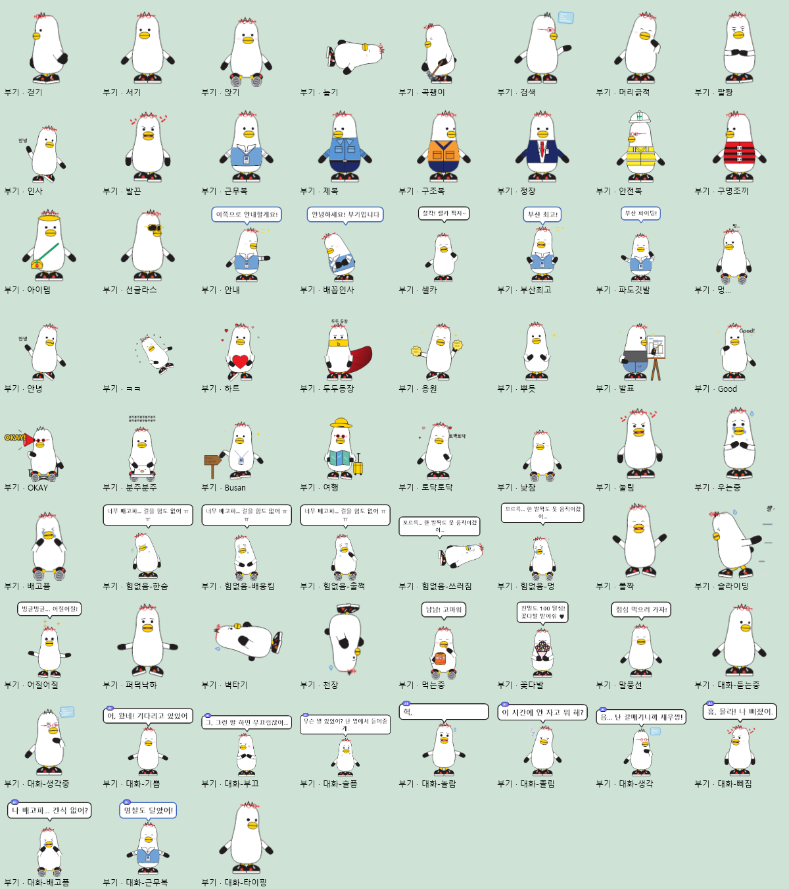

## 설치 및 실행

별도 설치 과정이 없습니다(Windows 10 / 11 기본 지원).

1. `output\bugi.exe` 파일을 내려받아 실행하면 바로 시작됩니다.
2. 모든 설정·기록·메모는 이 PC의 `%AppData%\부기\` 폴더에만 저장됩니다.
3. Windows 로그인 시 자동으로 켜려면 **설정 → 화면 · 시스템 → Windows 로그인 시 자동으로 켜기**를 켜 주세요.
4. 처음 실행하면 Windows 표시 언어에 맞춰 **한국어 / English** 가 자동 적용되며, 설정에서 언제든 바꿀 수 있습니다.

---

## 기본 조작

| 조작 | 동작 |
|---|---|
| **클릭** | 발끈 → 놀라 울기 → 폴짝 뛰기 순서로 반응(설정에서 변경 가능) |
| **더블클릭** · `Ctrl+Alt+B` | **AI 대화** 시작(말 걸기) |
| **끌어서 놓기 / 던지기** | 살짝 놓으면 날개를 퍼덕이며 천천히 하강, 휙 던지면 날아갔다 내려옴 |
| **커서 가까이 대면** | “쌩~” 하며 전력 질주로 도망(설정에서 따라오기·무시로 변경 가능) |
| **우클릭 · 트레이 아이콘** | 우클릭 = 메뉴 열기 / 트레이 아이콘 더블클릭 = 모두 숨기기 · 보이기 |

> **숨은 반응**: 머리 위에서 마우스를 한 바퀴 돌리면 **어질어질**, 친구 둘 이상일 때 커서를 4초 떼어 두면 **몰래 군무**, 같은 친구를 10초 안에 3번 던지면 **비밀 조종사** 동작이 나옵니다.

  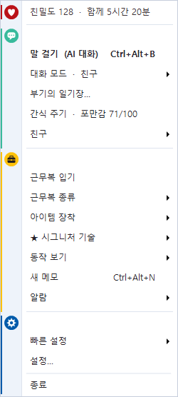
  &nbsp;&nbsp;
  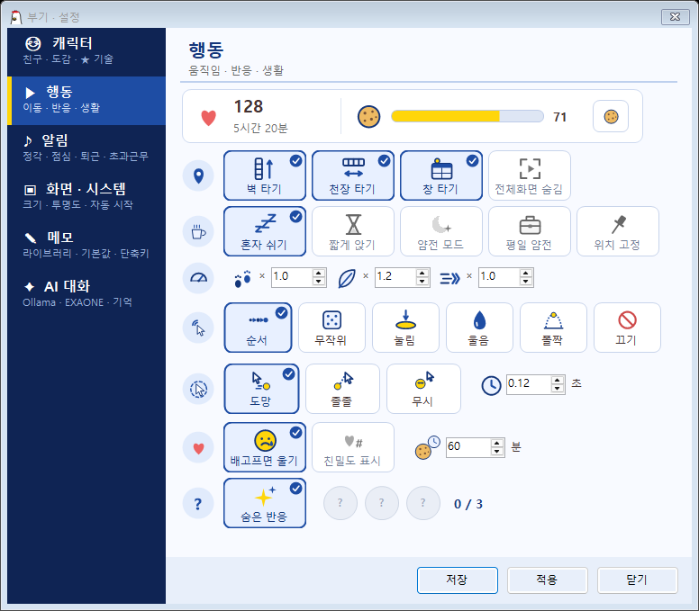

* **친밀도 · 간식 주기**: 함께 보내는 시간과 교류에 따라 친밀도가 쌓이고, 배고플 때 간식을 줄 수 있습니다.
* **행동 설정**: 벽·천장·열린 창 타기, 전체화면 숨김, 얌전 모드 · 평일 얌전 · 위치 고정, 이동 속도, 클릭·커서 반응을 원하는 대로 조절합니다.

---

## 캐릭터 · 옷차림 · 시그니처 기술

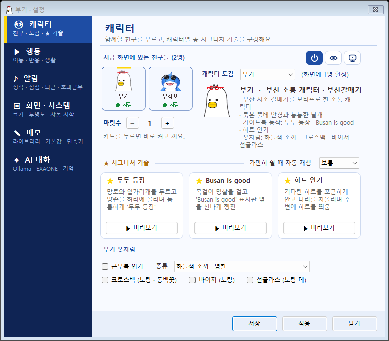

* **부기 & 부캉이**: 카드를 눌러 부기와 부캉이를 각각 켜고 끄거나, 여러 마리를 함께 화면에 부를 수 있습니다.
* **시그니처 기술 · 동작 보기**: 캐릭터별 대표 기술(부기: *두두 등장 · Busan is good · 하트 안기*, 부캉이: *부산 최고! · 파도 깃발 응원 · 액션캠 셀카*)과 다양한 응용동작을 바로 감상할 수 있습니다.
* **옷차림 · 아이템**: 근무복 6종(하늘색 조끼·제복·구조복·정장·안전복·구명조끼)과 아이템 3종(크로스백·바이저·선글라스)을 자유롭게 조합해 입힐 수 있습니다.
* **펫 전원**: 캐릭터 제목줄의 전원 버튼(또는 우클릭 → 친구 → 펫 전원 끄기)으로 캐릭터만 잠시 꺼 두어도 정각 · 점심 · 퇴근 · 내 알람 · 초과근무 알림은 그대로 울립니다.

부캉이(Bukangyee)의 다양한 모습 보기

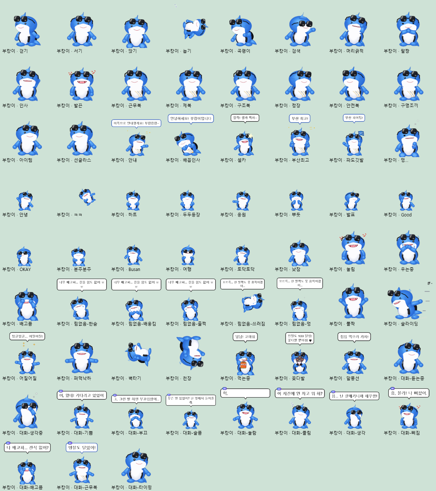

---

## 알림 · 알람

  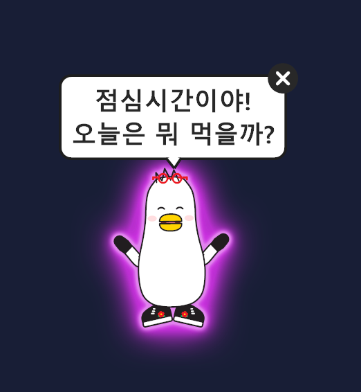
  &nbsp;&nbsp;
  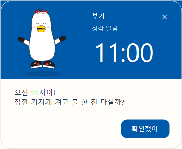

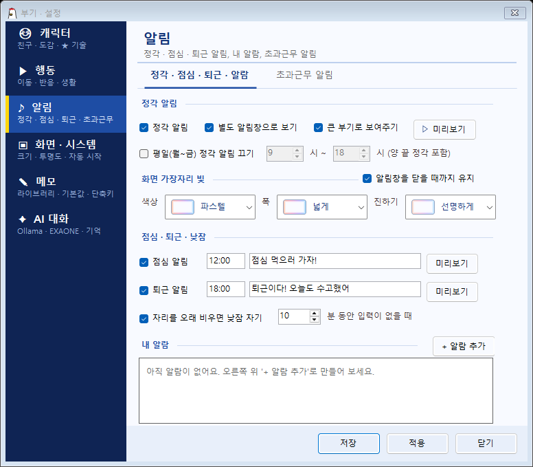

* **큰 부기 알림**: 정각 · 점심 · 퇴근 · 메모 알림이 울리면 부기가 2배 크기로 화면 가운데에 나와 네온 빛과 큰 말풍선으로 알려 줍니다. 클릭하거나 `×` 를 누르면 닫힙니다.
* **정각 알림창 · 화면 가장자리 빛**: 설정에서 “큰 부기로 보여주기”를 끄면 파랑 카드 알림창과 화면 가장자리 빛으로 알려 줍니다. 평일 특정 시간대에만 정각 알림을 끌 수도 있습니다.
* **점심 · 퇴근 · 낮잠 · 내 알람**: 원하는 시각과 문구로 알림을 맞추고, `+ 알람 추가` 로 개인 알람을 여러 개 등록할 수 있습니다.
* **초과근무 알림**: 설정 → 알림 → **초과근무 알림** 탭(또는 우클릭 → 알람 ▶)에서 초과근무하는 날에만 켜 두면, 기본근무·미사용 시간대를 제외한 초과근무 시간마다 매시 두 번 큰 부기 알림으로 기록을 챙겨 줍니다. 알림 부기를 왼쪽 클릭하면 해당 시간대가 바로 기록 완료로 표시되며, 다음 날이 되면 자동으로 꺼집니다.

---

## 바탕화면 메모

우클릭 → **새 메모** 또는 `Ctrl+Alt+N` 으로 바탕화면에 포스트잇 메모를 띄울 수 있습니다.

* **서식 · 체크리스트 · 태그 · 이미지**: `**굵게**` · `*기울임*` · `~~취소선~~` · 체크리스트(`- [ ]`) · 제목 · 링크 · 코드 · `#태그` 와 이미지 붙여넣기/끌어다 놓기를 지원합니다.
* **꾸미기 · 알림 · 기록 복원**: 8가지 색 · 크기 · 투명도 · 항상 위를 메모마다 저장하며, `⋯` 메뉴에서 1회/반복 알림을 걸거나 수정 전 내용으로 되돌릴 수 있습니다.
* **메모 라이브러리**: `Ctrl+Shift+F` 또는 **설정 → 메모**에서 노트북·태그별 분류, 검색, 일괄 이동·삭제를 한눈에 관리합니다.

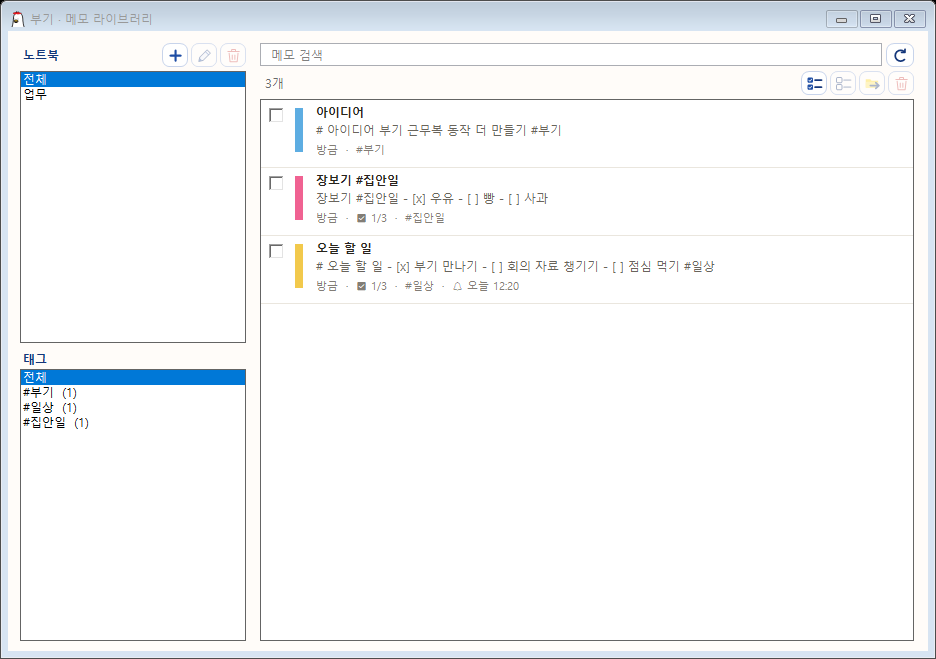

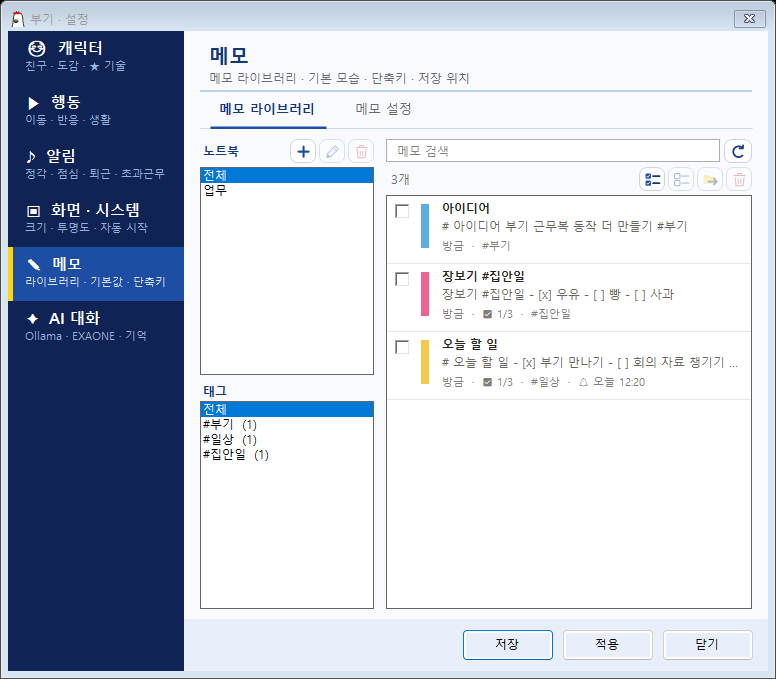

| 단축키 | 동작 |
|---|---|
| `Ctrl+Alt+N` | 새 메모 만들기 |
| `Ctrl+Shift+F` | 메모 라이브러리 열기 |
| `Ctrl+Shift+P` / `Ctrl+Shift+R` | 마지막 메모 항상 위 전환 / 1시간 뒤 알림 |
| `Ctrl+Enter` | 체크박스 켜고 끄기 |
| `Ctrl+B` / `I` / `U` / `Shift+X` | 굵게 / 기울임 / 밑줄 / 취소선 |
| `Ctrl+K` / `Ctrl+1~3` | 링크 넣기 / 제목 1~3단계 |

---

## AI 대화

  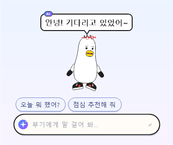

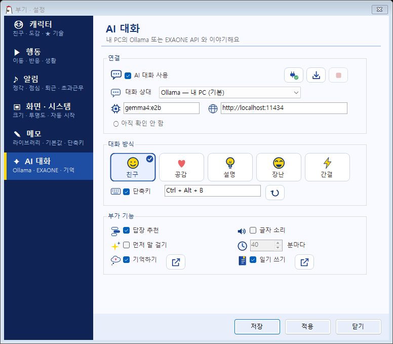

별도 채팅창 없이 바탕화면의 부기에게 바로 말을 걸 수 있습니다.

* **말 걸기**: 부기 **더블클릭**, 우클릭 → **말 걸기**, 또는 `Ctrl+Alt+B` 를 누르면 부기 발치에 입력칸이 뜹니다. `Esc` 나 바깥을 클릭하면 대화가 끝납니다.
* **간편한 시작 (Ollama · EXAONE)**: 기본은 내 PC의 [Ollama](https://ollama.com) 와만 주고받으며, **설정 → AI 대화**의 설치 버튼(`↓`)을 누르면 Ollama 설치(또는 업데이트)와 기본 모델 받기까지 한 번에 진행됩니다. 원하면 [EXAONE API](https://docs.exaone.ai/ko/docs/overview) 키를 연결해 사용할 수도 있습니다(외부 서버 전송 및 요금 발생 가능).
* **대화 방식 5가지**: **친구**(기본) · **공감** · **설명** · **장난** · **간결** 중 원하는 말투를 고를 수 있습니다.
* **생생한 반응과 부가 기능**: 대화 감정에 맞춰 표정과 동작이 바뀌며, **답장 추천 칩**(`Ctrl+1~3`), **기억하기**, **부기의 일기장**, 선택 기능(**글자 소리 · 먼저 말 걸기**)을 지원합니다.

---

## 화면 · 시스템 · 언어

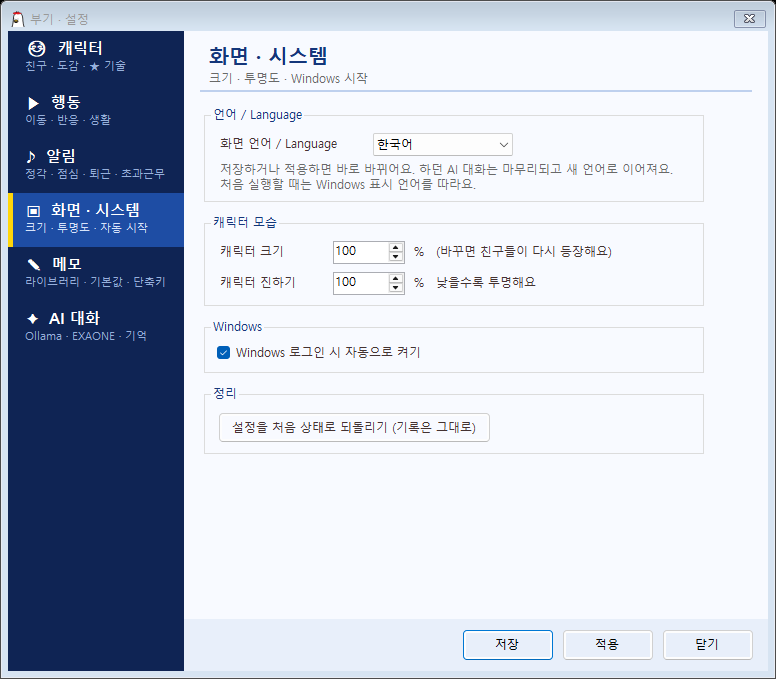

* **화면 언어**: **한국어**와 **English** 를 즉시 전환할 수 있습니다(메뉴 · 설정 · 메모 · 알림 · AI 대화 모두 반영).
* **크기 · 투명도 · 자동 시작**: 캐릭터 크기와 진하기를 조절하고, Windows 시작 시 자동 실행과 설정 초기화를 관리합니다.

---

> 부기 캐릭터의 저작권은 부산광역시에 있습니다. 이 프로젝트는 개인용 비상업적 팬 프로젝트입니다.
